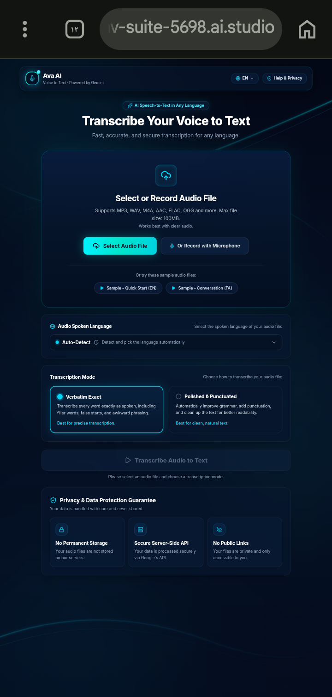

  

Avā AI — AI-Powered Audio Transcription

Avā AI is a multilingual speech-to-text application powered by Google's Gemini API. It converts audio recordings into editable text, with separate output modes for verbatim transcription and improved readability.

## 📸 Project Preview

✨ Key Features

1. Audio Input & Processing

- Upload audio files directly from your device.
- Record audio using your browser's microphone.
- Preview audio before transcription.
- Support for MP3, WAV, M4A, AAC, WebM, OGG, and FLAC formats.
- File size limit of approximately 100 MB.
- Audio duration limit of 75 minutes.
- Automatic audio duration inspection using FFprobe.
- Audio conversion and segmentation using FFmpeg.

2. Gemini-Powered Transcription

- Speech-to-text processing through Google's Gemini API.
- Automatic spoken-language detection.
- Manual language selection.
- Support for custom language input.
- Structured JSON responses for transcription results.
- Sequential audio processing for longer recordings.

Two transcription modes:

- Verbatim: Preserves spoken wording, repetitions, informal expressions, and natural speech patterns.
- Edited: Improves punctuation, spelling, and readability while retaining the original meaning.

3. Long-Audio Processing

Avā AI includes a chunk-based processing workflow for longer recordings.

- Audio files are divided into sequential segments.
- Each segment is processed individually.
- Transcription results are assembled in chronological order.
- Progress updates are delivered through Server-Sent Events (SSE).
- Partial transcription results can be displayed during processing.

4. Transcript Editing & Export

- Edit generated transcripts directly in the application.
- Switch between Verbatim and Edited outputs.
- Restore the original generated transcript.
- Copy text to the clipboard.
- Export transcripts as TXT files.
- View detected language, speaking tone, word count, and processing information.

5. Multilingual Interface

- Interface localization for 11 languages.
- Right-to-left (RTL) support for Persian and Arabic.
- Selectable spoken-language options.
- Custom language entry.
- Vazirmatn typography for Persian and Arabic text.
- Responsive interface for mobile and desktop devices.

🛠️ Technology Stack

Technology| Purpose
React 19| Frontend application
TypeScript| Type-safe development
Vite| Development and build tooling
Express.js| Backend server
Google Gemini API| AI-powered transcription
"@google/genai"| Gemini SDK integration
FFmpeg| Audio conversion and segmentation
FFprobe| Audio metadata and duration inspection
Multer| Multipart audio file uploads
Tailwind CSS| Interface styling
Motion| UI animations
Lucide React| Interface icons
dotenv| Environment configuration

⚙️ Backend Architecture

The application uses an Express.js backend to manage audio uploads and communicate with Gemini.

Main processing workflow:

1. The user uploads an audio file or records audio through the browser.
2. The frontend sends the audio to the backend.
3. The backend validates the uploaded file and checks its duration.
4. FFmpeg prepares the audio and splits longer recordings into smaller segments.
5. Each segment is sent to Gemini for transcription.
6. The backend combines the generated results.
7. Progress and completion events are delivered to the frontend using Server-Sent Events.
8. The user can review, edit, copy, or export the final transcript.

API Endpoints

Endpoint| Method| Purpose
"/api/health"| GET| Backend health and configuration status
"/api/transcribe-stream"| POST| Audio transcription with streaming progress
"/api/transcribe"| POST| Alternative transcription request

🔐 Privacy & Data Handling

- Gemini API requests are handled by the server.
- The API key is read from the server environment rather than exposed in frontend code.
- Uploaded audio is processed using temporary server-side files.
- The backend includes cleanup routines for uploaded files and temporary processing directories.
- No public transcript-sharing feature is required for the core workflow.

Users should review the application's privacy practices and deployment configuration before submitting sensitive recordings.

🧪 Testing & Real-World Usage

Avā AI has been tested with real audio recordings to evaluate its core transcription workflow.

Testing covered:

- Uploading and processing audio files.
- Generating Verbatim and Edited transcripts.
- Reviewing and editing generated text.
- Copying transcripts and exporting TXT files.
- Following the audio-processing workflow from upload to final output.

The purpose of testing was to evaluate how the main features work together in practical use.

Transcription quality may vary depending on audio clarity, background noise, accents, recording conditions, and language. Generated transcripts should be reviewed before being used for official or important purposes.

🚀 Project Goals

Avā AI aims to make audio transcription more accessible through a straightforward interface, multilingual support, and practical tools for reviewing and managing generated text.

The project brings together AI integration, audio processing, and user-focused interface design in a single application.

📌 Current Limitations

- Transcription requires a valid Gemini API key configured on the server.
- Processing time depends on audio length, network conditions, and model availability.
- Transcription accuracy is not guaranteed for every language or recording condition.
- Microphone recording depends on browser support and user permission.
- FFmpeg and FFprobe must be available in the deployment environment.

📄 License

Apache License 2.0.
